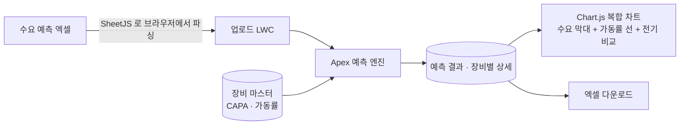
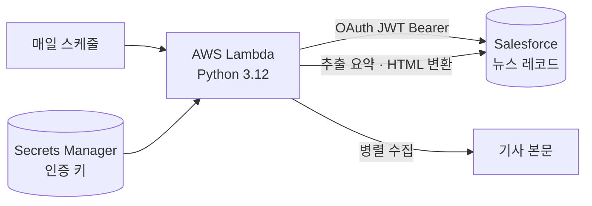

# 반도체 수요 · 장비 가동률 예측 (Salesforce)

> 반도체 제조 고객사의 Salesforce CRM 프로젝트. 고객 수요 예측(FCST)으로 장비별 생산능력과 가동률을 계산하는 예측 화면, 생성형 AI 분석 리포트, 생산계획 대비 실적, AWS Lambda 연동을 개발했습니다.

| 항목 | 내용 |
|---|---|
| 기간 | 2025.09 – 2026.03 |
| 역할 | 예측 · 분석 기능 개발, 외부 연동, CRM 화면 |
| 형태 | 회사 프로젝트 (고객사 구축) |
| 기술 | Apex, LWC, Chart.js, SheetJS, Agentforce, Einstein Prompt Template, Visualforce PDF, AWS Lambda (Python), Secrets Manager, S3 |

> 회사 프로젝트를 정리한 문서입니다. 고객사 이름, 실데이터, 장비 · 라인 정보, 산식의 고유 계수, 계정 · 엔드포인트는 포함하지 않습니다.

## 1. 수요 · 장비 가동률 예측

고객이 보내는 수요 예측 엑셀(제품, 장비, 테스트 시간, 주 · 월별 수요)을 올리면, 장비별 생산능력(CAPA)과 가동률을 계산해 차트로 보여 줍니다.

- 테스트 시간과 가동 시간으로 장비별 CAPA 를 구하고, 수요 / CAPA 로 기간별 가동률을 계산
- 월 단위 · 주 단위를 자동으로 판별하고, 실제 월 일수를 반영
- **최대 9,000행**을 한 번에 처리하기 위해 장비 마스터와 일수 계산을 캐시하고, 장비별 상세 레코드는 묶어서 생성
- 기간 라벨이 제각각인 엑셀을 위해 기간 정렬, 직전 기간 계산, 장비명 정규화 로직을 분리
- 기준 시작 기간을 바꾸면 트리거로 CAPA 와 가동률을 다시 계산

## 2. 생성형 AI 예측 분석 리포트

두 예측 버전과 장비, 자연어 질문을 넣으면 AI 가 비교 · 분석 리포트를 만들고, 저장 후 PDF 로 내보냅니다.

- LWC 에서 Agentforce 를 바로 호출할 수 없어 **LWC → Apex → Flow → Agentforce** 경로로 호출
- Invocable Action 에서 Einstein Prompt Template 을 불러 HTML 리포트 생성, 리포트 레코드에 저장
- Visualforce PDF 렌더링으로 리포트 출력, 같은 구조로 영업 · 시장 분석 에이전트도 구성
- 테스트에서는 AI 호출을 대체 응답으로 우회하고, 응답이 비면 기본 리포트를 반환

## 3. 생산계획 대비 실적 (Stagger Chart)

매월 다섯 달 치 생산계획과 실제 생산량을 입력하거나 CSV 로 올리면, 계획 대비 실적을 Stagger Chart 로 보여 주고 **달성률, 1개월 · 3개월 변동률**을 자동으로 계산합니다.

- 월별 입력 모달(Quick Action)과 CSV · 엑셀 업로드 두 가지 입력 방식
- 업로드용 CSV 파서를 Apex 로 직접 구현

## 4. AWS Lambda 뉴스 수집 · 요약

매일 한 번 Salesforce 의 뉴스 레코드 중 요약이 없는 기사를 찾아 본문을 수집하고 요약해 다시 Salesforce 에 반영합니다.

- 인증은 OAuth 2.0 JWT Bearer, 키는 Secrets Manager 에 보관
- 병렬 수집(스레드 5개), 문장 위치 · 키워드 · 숫자 기반 추출 요약
- 일정 건수마다 재연결하고, 실패하면 다른 조회 경로로 다시 시도
- Salesforce 쪽: 수신 메일에서 뉴스를 추출하는 Inbound Email 처리와 배치 스케줄러

## 5. 그 밖에

- **외부 파일 연동**: Apex REST 로 S3 사전 서명 주소를 받아, 파일을 내려받지 않고 Salesforce 파일 외부 링크로 레코드에 연결
- **CRM 화면**: 프로젝트 태스크 · 단계별 마일스톤, 거래처 리포트, 스코어보드, 범용 레코드 상세 컴포넌트

## 배운 점

- 예측 화면은 계산식보다 **고객이 보내는 데이터가 얼마나 제각각인지**를 받아 주는 쪽이 더 어렵다는 것
- Salesforce 밖(AWS)에서 도는 작업은 인증 · 재시도 · 비밀값 보관을 처음부터 같이 설계해야 한다는 것
